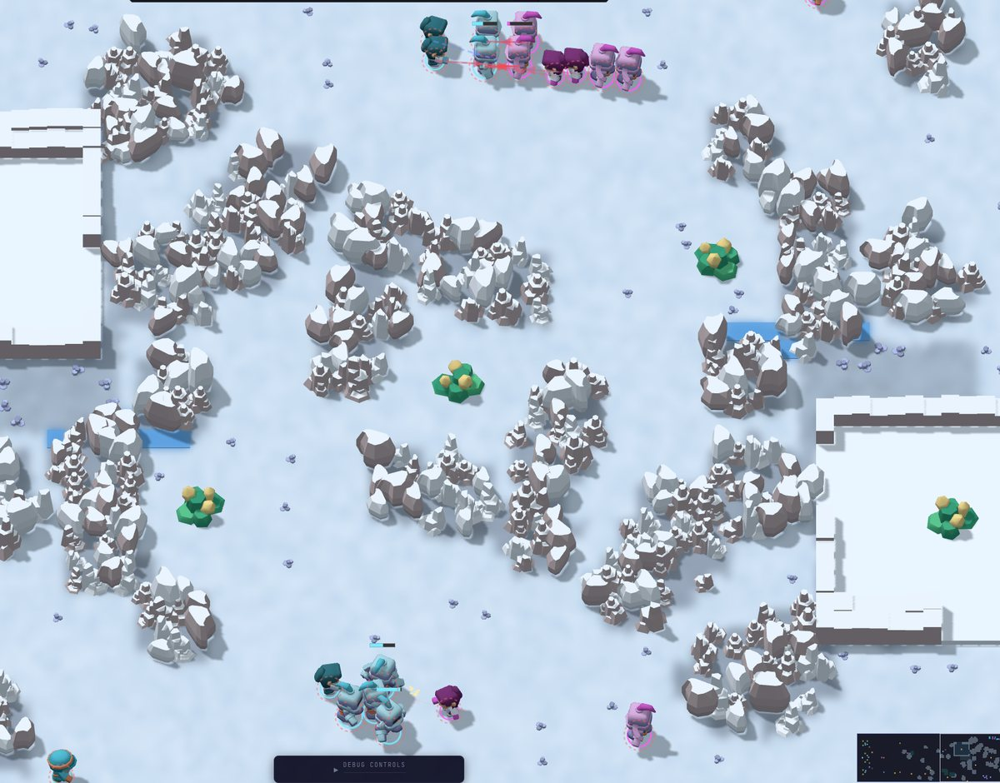
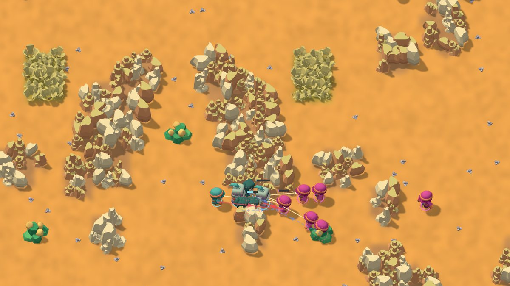
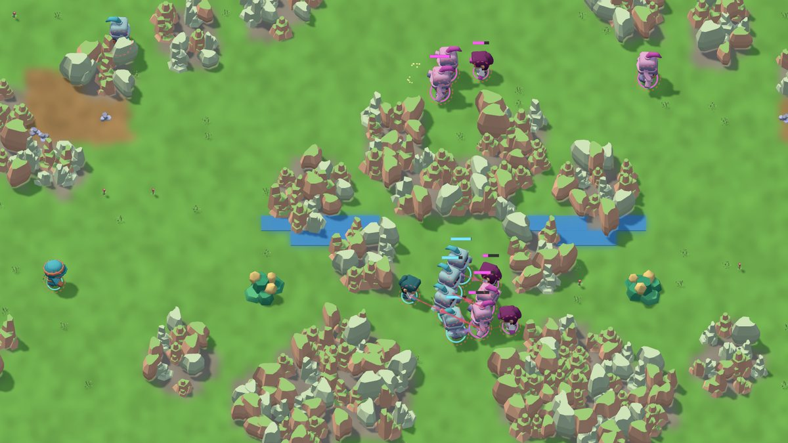
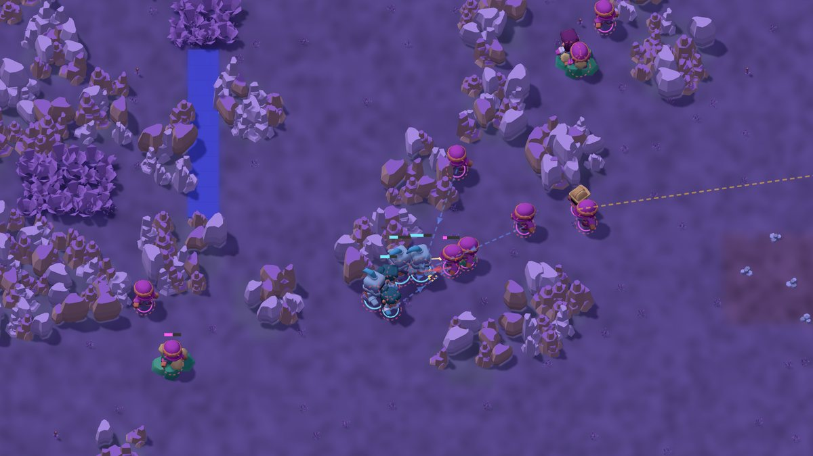
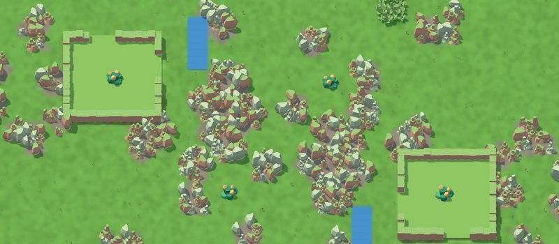
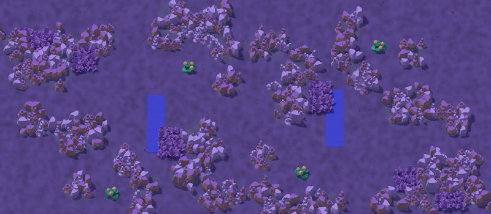

# CrystalFront RTS

A multiplayer browser-based real-time strategy game. 1v1 RTS with lobby system, worker-based building, resource gathering, unit combat, and server-authoritative gameplay. Web players get the low-poly 3D view by default; the original 2D view is one key (F3) or one setting away.

## Screenshots

Bot-vs-bot battles, captured from replays in the 3D view (blue vs magenta):

| | |
|---|---|
|  |  |
| **Shardfall** (frost) | **Cinder Flats** (desert) |
|  |  |
| **Glimmerfen** (verdant) | **Duskvale** (haunted) |

The map pool has ten maps in four themes:

| | |
|---|---|
|  |  |
| **Verdant**: Ironreed, Twin Spires, Glimmerfen | **Desert**: Basalt Run, Saltmarsh, Cinder Flats |
|  |  |
| **Haunted**: Duskvale, Hollow Crown | **Frost**: Shardfall, Prism Ridge |

## Project Structure

```
CrystalFront-RTS/
├── client/          # React + Vite frontend
├── server/          # Node.js + Express + ws backend
├── shared/          # Shared TypeScript types and constants
├── headless/        # Headless match runner and scripted bots
├── training/        # ML bot training (Python)
├── docs/            # Plans, release notes and screenshots
├── tests/           # Automated tests
├── package.json     # Root workspace config
└── tsconfig.json    # Root TypeScript config
```

## Quick Start

### Prerequisites

- Node.js 20+
- npm

### Install Dependencies

```bash
npm install
```

### Run Development Servers

```bash
npm run dev
```

This starts both the client (Vite dev server on port 5173) and server (on port 3777) concurrently. The client proxies API requests to the server.

### Run Tests

```bash
npm run test
```

### Build for Production

```bash
npm run build
```

This builds the client and server. The server output goes to `server/dist/`.

### Start Production Server

```bash
npm start
```

The server serves the built frontend and WebSocket API on port 3777.

## Configuration

### Port

The server port is configurable via the `PORT` environment variable:

```bash
PORT=8080 npm start
```

Defaults to `3777` if not set.

### Environment Variables

| Variable | Description | Default |
|----------|-------------|---------|
| `PORT` | Server port | `3777` |

## Deployment Guide

### Option 1: Systemd Service (Recommended for Production)

The production server is designed to run under a systemd service on a Debian/Ubuntu server.

#### Step 1: Prepare the Server

1. Update system packages:
```bash
sudo apt update && sudo apt upgrade -y
```

2. Install Node.js (if not already installed):
```bash
curl -fsSL https://deb.nodesource.com/setup_20.x | sudo -E bash -
sudo apt install -y nodejs
```

3. Create a dedicated user (optional but recommended):
```bash
sudo useradd -m -s /bin/bash crystalfront
sudo usermod -aG www-data crystalfront
```

#### Step 2: Deploy the Application

1. Copy the project to the server (e.g., `/opt/crystalfront-rts`):
```bash
# On local machine
scp -r . user@your-server:/opt/crystalfront-rts

# Or clone from git
ssh user@your-server
git clone https://github.com/Tom1tk/CrystalFront.git /opt/crystalfront-rts
cd /opt/crystalfront-rts
```

2. Install dependencies and build:
```bash
cd /opt/crystalfront-rts
npm install --production
npm run build
```

3. Set ownership:
```bash
sudo chown -R crystalfront:crystalfront /opt/crystalfront-rts
```

#### Step 3: Create Systemd Service

Create a systemd service file at `/etc/systemd/system/crystalfront-rts.service`:

```ini
[Unit]
Description=CrystalFront RTS Server
After=network.target

[Service]
Type=simple
User=crystalfront
Group=crystalfront
WorkingDirectory=/opt/crystalfront-rts
Environment=NODE_ENV=production
Environment=PORT=3777
ExecStart=/usr/local/bin/node server/dist/index.js
Restart=on-failure
RestartSec=5
# Restart if process uses more than 512MB memory
MemoryMax=1G

[Install]
WantedBy=multi-user.target
```

#### Step 4: Enable and Start the Service

```bash
# Reload systemd to recognize the new service
sudo systemctl daemon-reload

# Enable the service to start on boot
sudo systemctl enable crystalfront-rts

# Start the service
sudo systemctl start crystalfront-rts

# Check status
sudo systemctl status crystalfront-rts
```

#### Step 5: Verify the Deployment

1. Check if the service is running:
```bash
sudo systemctl is-active crystalfront-rts
```

2. Check logs:
```bash
sudo journalctl -u crystalfront-rts -f
```

3. Test the server:
```bash
curl http://localhost:3777
```

#### Managing the Service

```bash
# Start
sudo systemctl start crystalfront-rts

# Stop
sudo systemctl stop crystalfront-rts

# Restart
sudo systemctl restart crystalfront-rts

# View logs
sudo journalctl -u crystalfront-rts -f --since "1 hour ago"

# Check resource usage
systemctl status crystalfront-rts
```

### Option 2: Nginx Reverse Proxy (Recommended for Public Access)

For production deployment with HTTPS and domain name access:

#### Step 1: Install and Configure Nginx

```bash
sudo apt install nginx -y
```

#### Step 2: Create Nginx Configuration

Create `/etc/nginx/sites-available/crystalfront`:

```nginx
server {
    listen 80;
    server_name your-domain.com www.your-domain.com;

    # Security headers
    add_header X-Frame-Options "SAMEORIGIN" always;
    add_header X-Content-Type-Options "nosniff" always;
    add_header X-XSS-Protection "1; mode=block" always;

    # WebSocket support
    location / {
        proxy_pass http://localhost:3777;
        proxy_http_version 1.1;
        proxy_set_header Upgrade $http_upgrade;
        proxy_set_header Connection "upgrade";
        proxy_set_header Host $host;
        proxy_set_header X-Real-IP $remote_addr;
        proxy_set_header X-Forwarded-For $proxy_add_x_forwarded_for;
        proxy_set_header X-Forwarded-Proto $scheme;
        proxy_cache_bypass $http_upgrade;

        # Timeouts
        proxy_connect_timeout 60s;
        proxy_send_timeout 60s;
        proxy_read_timeout 60s;
    }

    # Static assets caching
    location ~* \.(js|css|png|jpg|jpeg|gif|ico|svg|woff|woff2|ttf|eot)$ {
        proxy_pass http://localhost:3777;
        expires 30d;
        add_header Cache-Control "public, immutable";
    }
}
```

#### Step 3: Enable the Site

```bash
# Create symlink
sudo ln -s /etc/nginx/sites-available/crystalfront /etc/nginx/sites-enabled/

# Remove default site (optional)
sudo rm /etc/nginx/sites-enabled/default

# Test configuration
sudo nginx -t

# Reload Nginx
sudo systemctl reload nginx
```

#### Step 4: Configure HTTPS with Let's Encrypt

```bash
# Install Certbot
sudo apt install certbot python3-certbot-nginx -y

# Obtain SSL certificate
sudo certbot --nginx -d your-domain.com -d www.your-domain.com

# Auto-renewal is configured automatically by Certbot
# Test renewal
sudo certbot renew --dry-run
```

### Option 3: Docker Deployment

#### Dockerfile

```dockerfile
FROM node:20-alpine

WORKDIR /app

# Copy package files
COPY package*.json ./
COPY client/package.json ./client/
COPY server/package.json ./server/
COPY shared/package.json ./shared/

# Install dependencies
RUN npm install --production

# Copy source
COPY . .

# Build
RUN npm run build

# Expose port
EXPOSE 3777

# Start server
CMD ["node", "server/dist/index.js"]
```

#### docker-compose.yml

```yaml
version: '3.8'

services:
  crystalfront:
    build: .
    ports:
      - "3777:3777"
    environment:
      - NODE_ENV=production
      - PORT=3777
    restart: unless-stopped
    # Optional: Add volume for logs
    # volumes:
    #   - ./logs:/app/logs
```

#### Deploy with Docker

```bash
# Build and run
docker-compose up -d

# View logs
docker-compose logs -f

# Update
docker-compose pull
docker-compose up -d --build
```

### Firewall Configuration

#### UFW (Ubuntu/Debian)

```bash
# Allow SSH (important!)
sudo ufw allow ssh

# Allow HTTP/HTTPS if using Nginx
sudo ufw allow http
sudo ufw allow https

# Or allow direct port access
sudo ufw allow 3777/tcp

# Enable firewall
sudo ufw enable
```

#### iptables

```bash
# Allow established connections
sudo iptables -A INPUT -m state --state ESTABLISHED,RELATED -j ACCEPT

# Allow SSH
sudo iptables -A INPUT -p tcp --dport 22 -j ACCEPT

# Allow HTTP/HTTPS
sudo iptables -A INPUT -p tcp --dport 80 -j ACCEPT
sudo iptables -A INPUT -p tcp --dport 443 -j ACCEPT

# Or allow direct port
sudo iptables -A INPUT -p tcp --dport 3777 -j ACCEPT
```

## Updating the Server

### With Systemd

```bash
# Navigate to project directory
cd /opt/crystalfront-rts

# Pull latest changes
git pull origin main

# Install dependencies and rebuild
npm install --production
npm run build

# Restart the service
sudo systemctl restart crystalfront-rts

# Check for errors
sudo journalctl -u crystalfront-rts -n 50
```

### With Docker

```bash
docker-compose pull
docker-compose up -d --build
```

## Monitoring and Maintenance

### Health Check

Create a simple health check script:

```bash
#!/bin/bash
# /usr/local/bin/crystalfront-health-check.sh

if ! curl -s --max-time 5 http://localhost:3777 > /dev/null; then
    echo "CrystalFront server is down!"
    sudo systemctl restart crystalfront-rts
fi
```

Add to crontab for periodic checks:
```bash
crontab -e
# Add: */5 * * * * /usr/local/bin/crystalfront-health-check.sh
```

### Log Rotation

The server logs to the systemd journal, not to individual log files. Log rotation is handled automatically by `journald`. To control journal log retention and size, configure `/etc/systemd/journald.conf`:

```ini
# Limit journal to 500MB
SystemMaxUse=500M

# Keep logs for 2 weeks
MaxRetentionSec=2week
```

Then restart journald:
```bash
sudo systemctl restart systemd-journald
```

To view server logs:
```bash
sudo journalctl -u crystalfront-rts -f
```

### Resource Monitoring

```bash
# Check memory usage
systemctl status crystalfront-rts | grep Memory

# Check CPU usage
top -p $(pgrep -f "server/dist/index.js")

# View real-time logs
sudo journalctl -u crystalfront-rts -f
```

## Troubleshooting

### Common Issues

1. **Port already in use**
```bash
# Find what's using the port
sudo lsof -i :3777
# Kill the process
sudo kill -9 <PID>
```

2. **Permission denied**
```bash
# Fix ownership
sudo chown -R crystalfront:crystalfront /opt/crystalfront-rts
```

3. **Service won't start**
```bash
# Check detailed logs
sudo journalctl -u crystalfront-rts -xe

# Test running manually
cd /opt/crystalfront-rts
node server/dist/index.js
```

4. **WebSocket connection fails**
- Ensure Nginx is configured with WebSocket upgrade headers
- Check firewall rules
- Verify CORS settings if accessing from different domain

### Debug Mode

To run in debug mode with verbose logging:

```bash
# Edit systemd service
sudo nano /etc/systemd/system/crystalfront-rts.service

# Add environment variable
Environment=DEBUG=*

# Restart
sudo systemctl restart crystalfront-rts
```

## Features

### Current Features

- **3D view (default)**: low-poly models (Kenney, CC0) with themed terrain. Press **F3** in a match, or use Settings → 3D View, to switch to the 2D view; the choice is remembered. `?view=2d` / `?view=3d` in the URL overrides it.
- **Maps**: a pool of 10 maps in four themes (verdant, desert, haunted, frost), with high ground, rock, brush and rivers. The host picks the map in the lobby, or leaves it random.
- **Fog of war** with terrain line of sight: high ground sees over low ground, rock blocks sight, and brush hides units.
- **Main Menu**: Username input, host game, join by lobby code, Play vs Bot, replays, settings (3D view, sound).
- **Lobby System**: Create/join lobbies with 6-character codes, ready-up flow, map picker.
- **Synchronised start**: a loading screen holds the match until both players have loaded, so both see the first tick together.
- **RTS Gameplay**:
  - Five unit types (worker, skirmisher, gunner, bruiser, medic) and four buildings (barracks, foundry, supply depot, turret)
  - Worker-based building, with several workers able to build together
  - Resource gathering with range limits
  - Unit movement, selection, attack-move and rally points
  - Combat system with range-based attacks
  - Win by destroying the enemy or by holding the map's control nodes
- **Bots**: Play vs Bot against scripted opponents (passive, rush variants, turtle, macro, heavy).
- **Replays**: every completed match is recorded; browse and play back at variable speed, forward or reverse.
- **Sound**: sound effects with an on/off setting.
- **Match Flow**: Both players ready → loading → gameplay → match end screen
- **Rematch**: Same lobby persists, score tracks across rematches
- **WebSocket Sync**: Real-time state synchronization between clients and server
- **Server-Authoritative**: Server is source of truth for all game state

### Planned Features

- Site-wide UI refresh to match the 3D look (see `docs/UI_PLAN.md`)
- Retrained ML bot that adapts to the opponent (see `docs/ML_RETRAIN_PLAN.md`)
- Unit upgrades and technology tree
- Reconnect on refresh
- Chat system
- External matchmaking

## Game Mechanics

### Building System

- Workers construct buildings by traveling to the placement location
- Multiple workers can contribute to the same building to speed up construction
- Construction progress only increases when workers are within range (60 units)
- Workers are occupied for the entire construction duration
- Building placement is restricted to the player's half of the map

### Resource Gathering

- Workers gather resources from nodes within range (60 units)
- Gathering is shown with visual indicators on the game map
- Workers can be reassigned from gathering to building or combat

### Combat

- Units attack enemies within their attack range
- Ranged units can attack from a distance
- Melee units must be close to enemies
- HP bars show current health above units

## License

Private project.

## Contributing

This is a private project. For questions or collaboration, please contact the repository owner.
